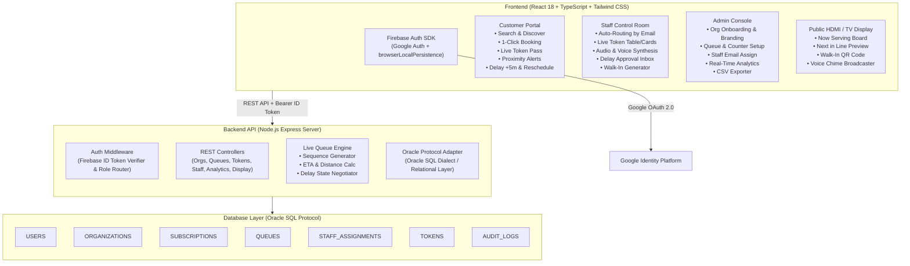
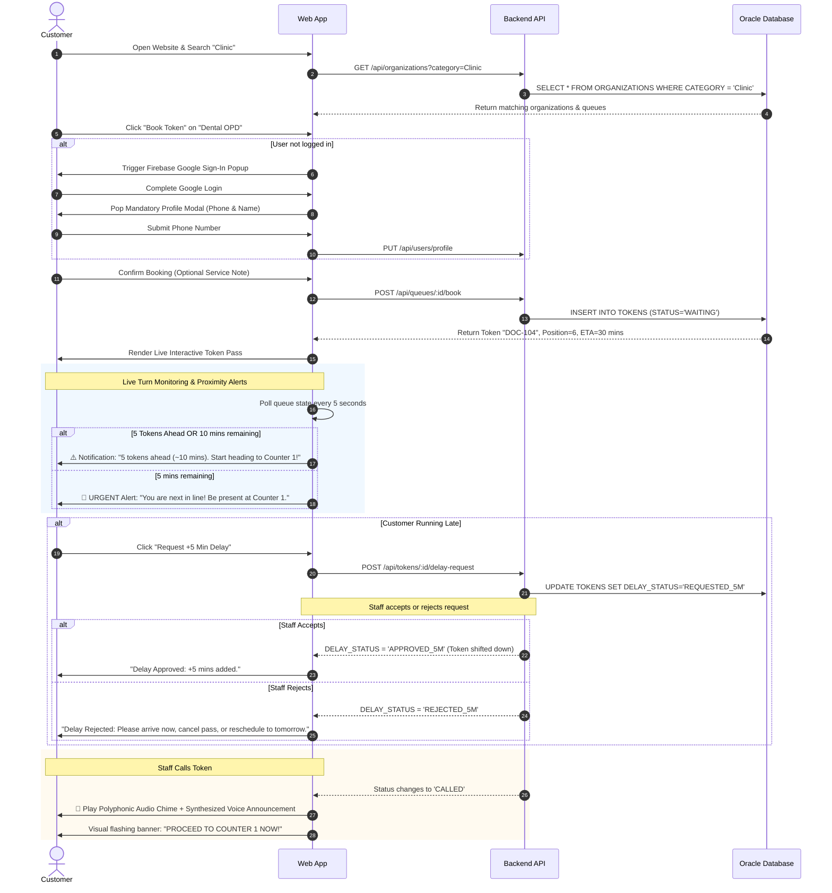
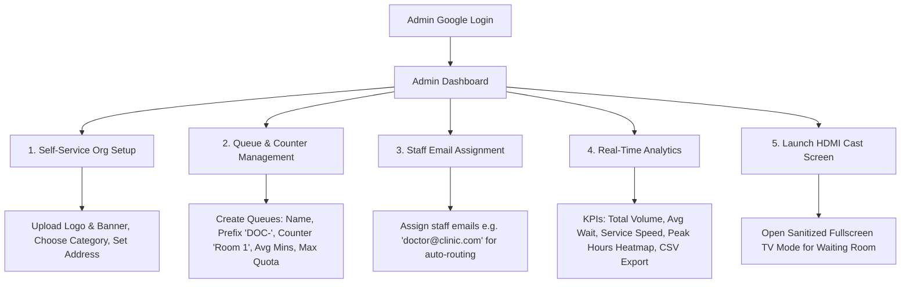

# Queless — Master Technical Implementation Plan & System Architecture

> **System Name:** Queless (Digital Token & Physical Queue Elimination Platform)  
> **Target Environment:** Localhost (Node.js Express + Oracle SQL Engine + Vite React 18 TypeScript)  
> **Production Target:** Oracle Cloud Infrastructure (OCI) + Oracle Database + Firebase Auth  
> **Document Version:** 2.0.0 (Comprehensive Master Plan)

---

## Table of Contents
1. [Executive Summary & Core Objectives](#1-executive-summary--core-objectives)
2. [System Architecture & Technology Stack](#2-system-architecture--technology-stack)
3. [Database Architecture & Oracle SQL DDL](#3-database-architecture--oracle-sql-ddl)
4. [Authentication, Session Persistence & Profile System](#4-authentication-session-persistence--profile-system)
5. [End-to-End User Flows & Detailed Role Breakdown](#5-end-to-end-user-flows--detailed-role-breakdown)
   - [5.1 Customer / Citizen Flow](#51-customer--citizen-flow)
   - [5.2 Staff / Queue Manager Flow & Button Specifications](#52-staff--queue-manager-flow--button-specifications)
   - [5.3 Admin / Business Owner Flow](#53-admin--business-owner-flow)
   - [5.4 Public HDMI / TV Waiting Room Display Flow](#54-public-hdmi--tv-waiting-room-display-flow)
6. [Delay Request & Proximity Notification Algorithms](#6-delay-request--proximity-notification-algorithms)
7. [REST API Specifications](#7-rest-api-specifications)
8. [Frontend Component Hierarchy & File Structure](#8-frontend-component-hierarchy--file-structure)
9. [Audio Chime & Web Speech Synthesis Engine](#9-audio-chime--web-speech-synthesis-engine)
10. [Localhost Execution & Oracle Cloud Migration Guide](#10-localhost-execution--oracle-cloud-migration-guide)

---

## 1. Executive Summary & Core Objectives

### The Problem
Physical waiting queues cause congestion, wasted time, lost revenue, customer frustration, and chaotic waiting rooms in clinics, banks, universities, salons, restaurants, and government offices. Customers are forced to stand in lines or wait hours in crowded spaces with no visibility into their turn.

### The Solution: Queless
**Queless** replaces physical lines with an intelligent, cloud-synchronized digital token system:
- **Zero Friction for Customers**: Search organizations by category, book digital tokens remotely or on-site, track live turn countdowns, receive smart advance notifications (5 tokens ahead / 5-10 min warning), request delays (+5 mins) with staff approval, and hear automated voice calls on their devices.
- **Precision for Staff**: Auto-routed directly to their assigned counter based on their Google Auth email. One-click queue controls (`Call Next`, `Start Serving`, `Complete`, `No-Show`, `Re-Chime`, `Transfer`, `Delay Review`, `Walk-In Issuer`, `Pause`).
- **Control for Admins**: Self-service organization onboarding (no pre-seeded dummy data), custom branding/logos, queue creator with prefix definitions, staff email assignment, real-time wait-time analytics, and CSV export.
- **Waiting Room TV / HDMI Cast Screen**: High-contrast, privacy-safe display for external monitors and TVs (displays only public token numbers, counter numbers, voice calls, and walk-in QR codes with zero customer private data).

---

## 2. System Architecture & Technology Stack



### Technology Matrix

| Layer | Technology | Rationale & Specifications |
| :--- | :--- | :--- |
| **Frontend Framework** | **React 18 (TypeScript)** with **Vite** | Blazing-fast development, strict type safety, modular component lifecycle. |
| **Styling & Design System** | **Tailwind CSS** + Custom Design Tokens | Glassmorphism dark/light aesthetic, micro-animations, responsive layout. |
| **Icons & Visuals** | **Lucide React** + **Canvas Confetti** | Crisp scalable vector icons and celebratory visual feedback. |
| **Authentication** | **Firebase Auth** (Google Provider) | Industry-standard OAuth 2.0 with permanent `browserLocalPersistence` in Chrome. |
| **Backend Framework** | **Node.js** + **Express.js (ES Modules)** | Asynchronous, lightweight REST microservices architecture. |
| **Database Engine** | **Oracle SQL Protocol** (`better-sqlite3` local engine) | Full Oracle SQL dialect (`VARCHAR2`, `NUMBER`, `TIMESTAMP`, `CLOB`, constraints) for zero-friction local execution and seamless migration to Oracle Autonomous Database Cloud. |
| **Audio & Speech Engine** | **Web Audio API** + **Web Speech Synthesis** | Polyphonic harmonic chime synthesis + localized natural language voice announcements. |
| **Display / HDMI Cast** | Window Cast / Fullscreen Standalone Route | Privacy-safe, sanitized payload rendering for external HDMI screens and TV monitors. |

---

## 3. Database Architecture & Oracle SQL DDL

The database schema follows strict Oracle relational standards. Below is the complete SQL DDL schema:

```sql
-- ====================================================================
-- Queless Master Oracle SQL DDL Schema
-- ====================================================================

-- 1. USERS TABLE
-- Stores authenticated users and profile completion state
CREATE TABLE USERS (
    USER_ID             VARCHAR2(128) NOT NULL,
    EMAIL               VARCHAR2(255) NOT NULL,
    DISPLAY_NAME        VARCHAR2(255),
    PHONE               VARCHAR2(30),
    PHOTO_URL           VARCHAR2(500),
    PROFILE_COMPLETE    NUMBER(1) DEFAULT 0 NOT NULL,
    ROLE                VARCHAR2(30) DEFAULT 'CUSTOMER' NOT NULL,
    CREATED_AT          TIMESTAMP DEFAULT CURRENT_TIMESTAMP NOT NULL,
    UPDATED_AT          TIMESTAMP DEFAULT CURRENT_TIMESTAMP NOT NULL,
    CONSTRAINT PK_USERS PRIMARY KEY (USER_ID)
);

-- 2. ORGANIZATIONS TABLE
-- Multi-tenant self-service enterprise business profiles
CREATE TABLE ORGANIZATIONS (
    ORG_ID              VARCHAR2(64) NOT NULL,
    NAME                VARCHAR2(255) NOT NULL,
    CATEGORY            VARCHAR2(50) NOT NULL, -- Clinic, Bank, University, Salon, Government, Restaurant, Retail, Other
    DESCRIPTION         VARCHAR2(2000),
    LOGO_URL            CLOB,                  -- Base64 or image URL
    BANNER_URL          CLOB,                  -- Cover image URL
    ADMIN_UID           VARCHAR2(128) NOT NULL,
    ADMIN_EMAIL         VARCHAR2(255) NOT NULL,
    SUBSCRIPTION_TIER   VARCHAR2(50) DEFAULT 'STARTER' NOT NULL, -- FREE, STARTER, PRO, ENTERPRISE
    ADDRESS             VARCHAR2(500),
    CITY                VARCHAR2(100),
    IS_ACTIVE           NUMBER(1) DEFAULT 1 NOT NULL,
    CREATED_AT          TIMESTAMP DEFAULT CURRENT_TIMESTAMP NOT NULL,
    UPDATED_AT          TIMESTAMP DEFAULT CURRENT_TIMESTAMP NOT NULL,
    CONSTRAINT PK_ORGANIZATIONS PRIMARY KEY (ORG_ID),
    CONSTRAINT FK_ORGS_USER FOREIGN KEY (ADMIN_UID) REFERENCES USERS(USER_ID)
);

-- 3. QUEUES TABLE
-- Service counters and token sequence configurations
CREATE TABLE QUEUES (
    QUEUE_ID            VARCHAR2(64) NOT NULL,
    ORG_ID              VARCHAR2(64) NOT NULL,
    NAME                VARCHAR2(255) NOT NULL, -- e.g. "Dental OPD Room 102", "Counter 4 - Cashier"
    PREFIX              VARCHAR2(10) DEFAULT 'Q-' NOT NULL, -- e.g. "DOC-", "CS-", "ADM-"
    COUNTER_LABEL       VARCHAR2(50) DEFAULT 'Counter 1' NOT NULL,
    AVG_SERVICE_MINS    NUMBER DEFAULT 10 NOT NULL,
    MAX_DAILY_TOKENS    NUMBER DEFAULT 0 NOT NULL, -- 0 = Unlimited
    CURRENT_TOKEN_SEQ   NUMBER DEFAULT 0 NOT NULL,
    IS_ACTIVE           NUMBER(1) DEFAULT 1 NOT NULL,
    IS_PAUSED           NUMBER(1) DEFAULT 0 NOT NULL, -- 1 = Online intake paused by staff
    OPERATING_HOURS     VARCHAR2(255) DEFAULT '09:00 - 17:00' NOT NULL,
    CREATED_AT          TIMESTAMP DEFAULT CURRENT_TIMESTAMP NOT NULL,
    CONSTRAINT PK_QUEUES PRIMARY KEY (QUEUE_ID),
    CONSTRAINT FK_QUEUES_ORG FOREIGN KEY (ORG_ID) REFERENCES ORGANIZATIONS(ORG_ID) ON DELETE CASCADE
);

-- 4. STAFF_ASSIGNMENTS TABLE
-- Maps staff email addresses to queues for automatic routing
CREATE TABLE STAFF_ASSIGNMENTS (
    ASSIGNMENT_ID       VARCHAR2(64) NOT NULL,
    QUEUE_ID            VARCHAR2(64) NOT NULL,
    ORG_ID              VARCHAR2(64) NOT NULL,
    STAFF_EMAIL         VARCHAR2(255) NOT NULL,
    STAFF_NAME          VARCHAR2(255),
    ROLE                VARCHAR2(50) DEFAULT 'OPERATOR' NOT NULL, -- OPERATOR, SENIOR_MANAGER
    CREATED_AT          TIMESTAMP DEFAULT CURRENT_TIMESTAMP NOT NULL,
    CONSTRAINT PK_STAFF_ASSIGNMENTS PRIMARY KEY (ASSIGNMENT_ID),
    CONSTRAINT FK_STAFF_QUEUE FOREIGN KEY (QUEUE_ID) REFERENCES QUEUES(QUEUE_ID) ON DELETE CASCADE,
    CONSTRAINT FK_STAFF_ORG FOREIGN KEY (ORG_ID) REFERENCES ORGANIZATIONS(ORG_ID) ON DELETE CASCADE
);

-- 5. TOKENS TABLE
-- Core token records, state machine, and delay negotiation
CREATE TABLE TOKENS (
    TOKEN_ID            VARCHAR2(64) NOT NULL,
    QUEUE_ID            VARCHAR2(64) NOT NULL,
    ORG_ID              VARCHAR2(64) NOT NULL,
    USER_ID             VARCHAR2(128) NOT NULL,
    TOKEN_NUMBER        VARCHAR2(30) NOT NULL, -- e.g. "DOC-104"
    TOKEN_SEQ           NUMBER NOT NULL,
    CUSTOMER_NAME       VARCHAR2(255) NOT NULL,
    CUSTOMER_PHONE      VARCHAR2(30) NOT NULL,
    SERVICE_NOTE        VARCHAR2(500),
    STATUS              VARCHAR2(30) DEFAULT 'WAITING' NOT NULL, -- WAITING, CALLED, SERVING, COMPLETED, NO_SHOW, CANCELLED
    DELAY_STATUS        VARCHAR2(30) DEFAULT 'NONE' NOT NULL,    -- NONE, REQUESTED_5M, APPROVED_5M, REJECTED_5M, RESCHEDULED
    DELAY_REQUESTED_AT  TIMESTAMP,
    POSITION_IN_QUEUE   NUMBER DEFAULT 0 NOT NULL,
    ESTIMATED_WAIT_MINS NUMBER DEFAULT 0 NOT NULL,
    BOOKING_DATE        VARCHAR2(10) NOT NULL, -- YYYY-MM-DD
    CALLED_AT           TIMESTAMP,
    SERVE_STARTED_AT    TIMESTAMP,
    COMPLETED_AT        TIMESTAMP,
    CREATED_AT          TIMESTAMP DEFAULT CURRENT_TIMESTAMP NOT NULL,
    CONSTRAINT PK_TOKENS PRIMARY KEY (TOKEN_ID),
    CONSTRAINT FK_TOKENS_QUEUE FOREIGN KEY (QUEUE_ID) REFERENCES QUEUES(QUEUE_ID) ON DELETE CASCADE,
    CONSTRAINT FK_TOKENS_ORG FOREIGN KEY (ORG_ID) REFERENCES ORGANIZATIONS(ORG_ID) ON DELETE CASCADE
);

-- 6. AUDIT_LOGS TABLE
-- Historical analytics, durations, and operational metrics
CREATE TABLE AUDIT_LOGS (
    LOG_ID              VARCHAR2(64) NOT NULL,
    ORG_ID              VARCHAR2(64) NOT NULL,
    QUEUE_ID            VARCHAR2(64),
    TOKEN_ID            VARCHAR2(64),
    ACTION              VARCHAR2(100) NOT NULL,
    ACTOR_UID           VARCHAR2(128) NOT NULL,
    DETAILS             VARCHAR2(1000),
    DURATION_SECONDS    NUMBER DEFAULT 0,
    WAIT_SECONDS        NUMBER DEFAULT 0,
    CREATED_AT          TIMESTAMP DEFAULT CURRENT_TIMESTAMP NOT NULL,
    CONSTRAINT PK_AUDIT_LOGS PRIMARY KEY (LOG_ID)
);

-- INDEXES FOR MAXIMUM QUERY PERFORMANCE
CREATE INDEX IDX_USERS_EMAIL ON USERS(EMAIL);
CREATE INDEX IDX_ORGS_CATEGORY ON ORGANIZATIONS(CATEGORY);
CREATE INDEX IDX_ORGS_ADMIN ON ORGANIZATIONS(ADMIN_EMAIL);
CREATE INDEX IDX_STAFF_EMAIL ON STAFF_ASSIGNMENTS(STAFF_EMAIL);
CREATE INDEX IDX_TOKENS_QUEUE_STATUS ON TOKENS(QUEUE_ID, STATUS);
CREATE INDEX IDX_TOKENS_USER ON TOKENS(USER_ID);
CREATE INDEX IDX_TOKENS_DATE ON TOKENS(BOOKING_DATE);
```

---

## 4. Authentication, Session Persistence & Profile System

### 4.1 Firebase Google Auth Setup
- **Single Provider**: Firebase Authentication is configured strictly with **Google Sign-In**.
- **Browser Local Persistence**:
  ```typescript
  import { initializeApp } from 'firebase/app';
  import { getAuth, setPersistence, browserLocalPersistence, GoogleAuthProvider } from 'firebase/auth';

  const auth = getAuth(app);
  // Guarantee permanent Chrome session persistence
  await setPersistence(auth, browserLocalPersistence);
  ```
- Once signed in on Google Chrome, the session cookie and OAuth token remain cached permanently. The user will **never** be prompted to log in again upon opening new tabs or restarting the browser.

### 4.2 Mandatory Non-Skippable Profile Completion
1. **Trigger Condition**: When a user logs in for the first time, `USERS.PROFILE_COMPLETE` is `0`.
2. **Behavior**: A full-screen modal pops up that **cannot be closed, dismissed, or skipped**:
   - `Full Name`: Pre-populated from Google profile (editable).
   - `Phone Number`: **Required** with numeric validation.
   - `Submit Profile Button`: Sends `PUT /api/users/profile` and sets `PROFILE_COMPLETE = 1`.
3. **Secondary Booking Check**: If any customer attempts to click "Book Token" without having completed their profile, the modal instantly blocks the action until their name and phone number are submitted.

### 4.3 Dynamic Role Resolution
Every time a request reaches the backend:
1. The backend decodes the Firebase ID Token to retrieve `decodedToken.email` and `decodedToken.uid`.
2. The role is evaluated dynamically in priority order:
   - **ADMIN**: If `email == ORGANIZATIONS.ADMIN_EMAIL`.
   - **STAFF**: If `email IN (SELECT STAFF_EMAIL FROM STAFF_ASSIGNMENTS)`.
   - **CUSTOMER**: If neither of the above.
3. The response payload returns `{ user, role, assignedQueues, adminOrgs }`.

---

## 5. End-to-End User Flows & Detailed Role Breakdown

### 5.1 Customer / Citizen Flow



---

### 5.2 Staff / Queue Manager Flow & Button Specifications

#### Staff Auto-Routing
When a staff member logs in using their Google account (e.g. `reception@cityhealth.com`), the backend matches their email against `STAFF_ASSIGNMENTS`. The system skips customer discovery entirely and routes them **straight into their Live Staff Control Room** for their assigned counter.

#### Detailed Action Button Specifications

```text
+-------------------------------------------------------------------------------------------------------+
|                                  STAFF QUEUE CONTROL TOOLBAR                                          |
|  [📢 Call Next]   [▶️ Start Serving]   [✅ Complete]   [⚠️ Mark No-Show]   [🔔 Re-Chime]   [🔀 Transfer]  |
|  [⏳ Delay Inbox] [🎟️ Walk-In Token]  [⏸️ Pause Queue] [📺 Launch HDMI Screen]                         |
+-------------------------------------------------------------------------------------------------------+
```

1. **`📢 Call Next Token`**:
   - **Trigger**: Clicks "Call Next".
   - **Backend Action**: Finds the next available token with `STATUS = 'WAITING'` ordered by `TOKEN_SEQ ASC`.
   - **Database Update**: Sets `STATUS = 'CALLED'`, `CALLED_AT = CURRENT_TIMESTAMP`.
   - **Audio Broadcast**: Browser triggers synthetic polyphonic bell chime + Web Speech: *"Now calling Token DOC-104 to Counter 1"*.
   - **Customer Device Alert**: Sends live event to customer's browser pass (triggers vibration/sound on customer device).

2. **`▶️ Start Serving`**:
   - **Trigger**: When customer arrives at the counter.
   - **Backend Action**: Sets `STATUS = 'SERVING'`, `SERVE_STARTED_AT = CURRENT_TIMESTAMP`.
   - **UI Impact**: Starts active stop-watch timer on staff console; customer pass shows *"You are currently being served"*.

3. **`✅ Complete Service`**:
   - **Trigger**: Consultation or service transaction concludes.
   - **Backend Action**: Sets `STATUS = 'COMPLETED'`, `COMPLETED_AT = CURRENT_TIMESTAMP`.
   - **Audit Calculation**: Computes `DURATION_SECONDS = (COMPLETED_AT - SERVE_STARTED_AT)` and `WAIT_SECONDS = (SERVE_STARTED_AT - CREATED_AT)`. Inserts record into `AUDIT_LOGS`.
   - **Customer Pass**: Displays celebratory completion checkmark and archives ticket to "My History".

4. **`⚠️ Mark No-Show`**:
   - **Trigger**: Customer was called multiple times but failed to appear.
   - **Backend Action**: Sets `STATUS = 'NO_SHOW'`. Unblocks the counter and advances queue.
   - **Customer Pass**: Updates to *"You did not appear when called. Token marked as No-Show"*.

5. **`🔔 Re-Chime / Re-Call`**:
   - **Trigger**: Customer is distracted or in a noisy waiting area.
   - **Backend Action**: Repeats polyphonic chime and voice synthesis broadcast for the active `CALLED` token without altering timestamps or sequence.

6. **`🔀 Transfer Token`**:
   - **Trigger**: Customer needs to be routed to another department (e.g. from General OPD to Billing Counter or Lab).
   - **Action**: Staff picks destination queue from dropdown. System updates `QUEUE_ID`, sets `STATUS = 'WAITING'`, and notifies customer: *"You have been transferred to Laboratory Counter 2"*.

7. **`⏳ Review Delay Requests (Accept / Reject)`**:
   - **Trigger**: Staff sees pending badge for customer +5m delay requests.
   - **Accept Action**: Shifts token 2 slots down in queue order, sets `DELAY_STATUS = 'APPROVED_5M'`, notifies customer.
   - **Reject Action**: Sets `DELAY_STATUS = 'REJECTED_5M'`, notifies customer with fallback options (proceed now, cancel, or reschedule).

8. **`🎟️ Issue Walk-In Token`**:
   - **Trigger**: On-site visitor without smartphone arrives at counter.
   - **Action**: Staff enters name and phone number; token is immediately issued and slotted into sequence.

9. **`⏸️ Pause / Resume Queue`**:
   - **Trigger**: Lunch break, doctor emergency, or temporary stoppage.
   - **Action**: Sets `QUEUES.IS_PAUSED = 1`. Online booking buttons show *"Intake Paused"*. Already-issued waiting tokens can still be called and served.

---

### 5.3 Admin / Business Owner Flow



1. **Zero Pre-Seeded Data / Self-Service Onboarding**:
   - Any enterprise (hospital, college, bank, salon) signs up on the website.
   - Completes onboarding: Organization Name, Category dropdown, Description, Logo upload, Banner upload, Address, Subscription plan selection.
2. **Queue Architecture**:
   - Admin creates counters with custom prefix codes (e.g. `DOC-` for Doctor, `BNK-` for Cashier, `ADM-` for University Admissions).
   - Configures average service duration per ticket and maximum daily token capacity.
3. **Staff Delegation**:
   - Admin enters staff email addresses (e.g. `nurse.clara@hospital.com`).
   - Staff members are instantly authorized to operate that queue upon logging in with Google.
4. **Analytics & Performance Monitoring**:
   - Daily visitor volume graph.
   - Hourly rush-hour distribution heatmap.
   - Staff productivity index (average service time per operator).
   - One-click CSV export of historical records.

---

### 5.4 Public HDMI / TV Waiting Room Display Flow

Both Staff and Admin dashboards feature a prominent **`📺 Launch HDMI Cast Screen`** button.

```text
+-------------------------------------------------------------------------------------------------------+
|  [LOGO] CITY HEALTH CLINIC & DIAGNOSTICS                                        11:45 AM | LIVE       |
+-------------------------------------------------------------------------------------------------------+
|                                                                                                       |
|      ╔═════════════════════════════════════════╗        ╔═══════════════════════════════════════╗     |
|      ║              NOW SERVING                ║        ║             NEXT IN LINE              ║     |
|      ║                                         ║        ║                                       ║     |
|      ║              DOC-104                    ║        ║        1. DOC-105                     ║     |
|      ║                                         ║        ║        2. DOC-106                     ║     |
|      ║         --> COUNTER 1 (ROOM 102) <--    ║        ║        3. DOC-107                     ║     |
|      ║                                         ║        ║        4. DOC-108                     ║     |
|      ╚═════════════════════════════════════════╝        ╚═══════════════════════════════════════╝     |
|                                                                                                       |
|  ---------------------------------------------------------------------------------------------------  |
|   [ QR CODE ] Scan to get your digital token from your phone               Audio Broadcaster: ACTIVE  |
+-------------------------------------------------------------------------------------------------------+
```

#### Key Characteristics of HDMI Screen:
- **Zero Privacy Leakage**: Does NOT display customer names, phone numbers, staff notes, or internal controls.
- **High-Contrast Dark Theme**: Designed specifically for high visibility on wall-mounted TVs, monitors, and HDMI splitters.
- **Hardware Audio Sync**: Runs Web Audio and Web Speech synthesis engine through the connected HDMI cable to waiting room speakers.
- **Live Polling Refresh**: Continuously syncs token states every 3 seconds.

---

## 6. Delay Request & Proximity Notification Algorithms

### 6.1 Proximity Calculation Algorithm
```typescript
interface ProximityAlert {
  level: 'NONE' | 'ADVANCE_10M' | 'URGENT_5M';
  message: string;
  peopleAhead: number;
  estimatedMinutes: number;
}

function calculateProximityAlert(
  tokenPosition: number, 
  avgServiceMins: number
): ProximityAlert {
  const estimatedMins = tokenPosition * avgServiceMins;

  if (tokenPosition <= 1 || estimatedMins <= 5) {
    return {
      level: 'URGENT_5M',
      message: '🚨 URGENT: You are next in line! Please be present at the counter immediately.',
      peopleAhead: tokenPosition - 1,
      estimatedMinutes: estimatedMins
    };
  }

  if (tokenPosition <= 5 || estimatedMins <= 10) {
    return {
      level: 'ADVANCE_10M',
      message: `⚠️ Heads Up: You have ${tokenPosition} tokens ahead (~${estimatedMins} mins remaining). Please start heading towards the counter area.`,
      peopleAhead: tokenPosition - 1,
      estimatedMinutes: estimatedMins
    };
  }

  return {
    level: 'NONE',
    message: '',
    peopleAhead: tokenPosition - 1,
    estimatedMinutes: estimatedMins
  };
}
```

### 6.2 Delay Negotiation Algorithm (+5 Min Shift)
1. Customer clicks **`Request +5 Min Delay`**.
2. System verifies token is in `WAITING` status and not currently `CALLED`.
3. Sets `DELAY_STATUS = 'REQUESTED_5M'` and records `DELAY_REQUESTED_AT`.
4. Staff console highlights pending delay in amber.
5. **If Approved by Staff**:
   - `DELAY_STATUS` becomes `'APPROVED_5M'`.
   - `TOKEN_SEQ` is incremented by $+2$ positions, letting 2 waiting customers move ahead (equivalent to ~5-10 minutes delay).
   - Recalculates queue positions for all affected tokens.
6. **If Rejected by Staff**:
   - `DELAY_STATUS` becomes `'REJECTED_5M'`.
   - Customer UI displays: *"Staff could not grant delay. Please arrive now, cancel pass, or reschedule to tomorrow."*

---

## 7. REST API Specifications

Base URL: `http://localhost:5000/api`  
All protected routes require header: `Authorization: Bearer <Firebase_ID_Token>`

### Endpoints Table

| Category | Method | Endpoint | Description | Access Role |
| :--- | :--- | :--- | :--- | :--- |
| **Auth & Profile** | `POST` | `/auth/verify` | Verify Firebase token, create user, return roles | Public / Auth |
| | `PUT` | `/users/profile` | Mandatory profile completion (name, phone) | Authenticated |
| | `GET` | `/users/me` | Retrieve profile and active session roles | Authenticated |
| **Organizations** | `GET` | `/organizations` | Search & filter organizations by category/city | Public |
| | `GET` | `/organizations/:id` | Get organization details and active queues | Public |
| | `POST` | `/organizations` | Self-service organization onboarding | Authenticated (becomes Admin) |
| | `PUT` | `/organizations/:id` | Update organization profile, logo, banner | Admin Only |
| **Queues** | `GET` | `/organizations/:orgId/queues` | List all queues under an organization | Public |
| | `POST` | `/organizations/:orgId/queues` | Create new queue with prefix and counters | Admin Only |
| | `PUT` | `/queues/:id` | Edit queue parameters | Admin Only |
| | `DELETE` | `/queues/:id` | Delete queue | Admin Only |
| | `POST` | `/queues/:id/pause` | Pause / resume queue bookings | Staff / Admin |
| **Staff Routing** | `GET` | `/queues/:id/staff` | List assigned staff emails for queue | Admin Only |
| | `POST` | `/queues/:id/staff` | Assign staff email address to queue | Admin Only |
| | `DELETE` | `/staff-assignments/:id` | Remove staff assignment | Admin Only |
| | `GET` | `/staff/my-queues` | Retrieve queues assigned to authenticated staff email | Staff |
| **Tokens & Ops** | `POST` | `/queues/:id/book` | Book token with profile validation | Authenticated Customer |
| | `GET` | `/tokens/my-tokens` | Get user's active and past tokens | Authenticated Customer |
| | `GET` | `/queues/:id/tokens` | Get full queue board (table/cards) | Staff / Admin |
| | `POST` | `/tokens/:id/call` | Call next token (triggers voice/chime) | Staff |
| | `POST` | `/tokens/:id/serve` | Mark token as actively serving | Staff |
| | `POST` | `/tokens/:id/complete` | Complete service & record metrics | Staff |
| | `POST` | `/tokens/:id/no-show` | Mark token as no-show | Staff |
| | `POST` | `/tokens/:id/cancel` | Cancel active token pass | Customer / Staff |
| | `POST` | `/tokens/:id/delay-request`| Request +5 min delay | Customer |
| | `POST` | `/tokens/:id/delay-approve`| Approve +5 min delay | Staff |
| | `POST` | `/tokens/:id/delay-reject` | Reject +5 min delay | Staff |
| | `POST` | `/tokens/:id/reschedule` | Reschedule token to next operating date | Customer |
| | `POST` | `/tokens/:id/transfer` | Transfer token to another queue | Staff |
| | `POST` | `/queues/:id/walk-in` | Issue instant walk-in token | Staff |
| **HDMI Screen** | `GET` | `/queues/:id/display` | Sanitized public waiting room payload | Public |
| **Analytics** | `GET` | `/organizations/:id/analytics` | Hourly volume, avg wait, staff performance | Admin |
| | `GET` | `/organizations/:id/analytics/export` | Download complete token history as CSV | Admin |

---

## 8. Frontend Component Hierarchy & File Structure

```text
c:\Users\Administrator\OneDrive\Desktop\queless\
├── IMPLEMENTATION_PLAN.md
├── index.html
├── package.json
├── tsconfig.json
├── vite.config.ts
├── server/
│   ├── package.json
│   ├── index.js                     # Express app setup & route mounting
│   ├── database/
│   │   ├── db.js                    # better-sqlite3 engine with Oracle DDL schema
│   │   └── schema.sql               # Master Oracle SQL DDL script
│   ├── middleware/
│   │   └── auth.js                  # Firebase token verification & role extractor
│   └── routes/
│       ├── auth.js                  # Verify & role routing
│       ├── users.js                 # Profile completion
│       ├── organizations.js         # Org onboarding & discovery
│       ├── queues.js                # Queue management & pause
│       ├── staff.js                 # Staff assignments & auto-routing
│       ├── tokens.js                # Token lifecycle, delay, walk-in, transfer
│       ├── display.js               # Sanitized HDMI screen data
│       └── analytics.js             # KPIs & CSV exporter
├── src/
│   ├── main.tsx
│   ├── App.tsx                      # App router & global modals
│   ├── index.css                    # Tailwind design system & animations
│   ├── config/
│   │   └── firebase.ts              # Firebase Google Auth with browserLocalPersistence
│   ├── types/
│   │   └── index.ts                 # Full TypeScript interfaces
│   ├── services/
│   │   ├── api.ts                   # Fetch wrapper with Bearer token injection
│   │   └── audio.ts                 # Web Audio chime + Web Speech announcer
│   ├── hooks/
│   │   ├── useAuth.ts               # Auth state, login/logout, profile completion
│   │   └── usePolling.ts            # High-performance state synchronizer
│   ├── components/
│   │   ├── common/
│   │   │   ├── Button.tsx
│   │   │   ├── Badge.tsx
│   │   │   ├── Card.tsx
│   │   │   ├── Modal.tsx
│   │   │   ├── Input.tsx
│   │   │   ├── Select.tsx
│   │   │   └── Spinner.tsx
│   │   ├── layout/
│   │   │   ├── Header.tsx           # Nav, role switch, auth state
│   │   │   ├── Footer.tsx
│   │   │   └── AppShell.tsx
│   │   ├── auth/
│   │   │   ├── LoginButton.tsx
│   │   │   └── ProfileCompletionModal.tsx # Non-skippable mandatory popup
│   │   ├── customer/
│   │   │   ├── SearchBar.tsx
│   │   │   ├── CategoryFilter.tsx   # Category pills (Clinics, Banks, Universities, etc.)
│   │   │   ├── OrgCard.tsx
│   │   │   ├── QueueCard.tsx
│   │   │   ├── BookingModal.tsx     # 1-click token booking
│   │   │   ├── LiveTokenPass.tsx    # Live countdown, QR, proximity alerts, +5m delay
│   │   │   └── TokenHistoryCard.tsx
│   │   ├── staff/
│   │   │   ├── StaffDashboard.tsx   # Auto-routed queue control room
│   │   │   ├── TokenQueueBoard.tsx  # Cards vs Table view
│   │   │   ├── TokenRow.tsx         # Action buttons (Call, Serve, Complete, No-Show, etc.)
│   │   │   ├── DelayRequestsPanel.tsx # Accept / Reject +5m delay requests
│   │   │   ├── WalkInTokenModal.tsx # Walk-in ticket issuer
│   │   │   ├── TransferTokenModal.tsx # Transfer to other counters
│   │   │   └── HDMICastButton.tsx   # 1-click public TV launcher
│   │   ├── admin/
│   │   │   ├── AdminDashboard.tsx
│   │   │   ├── OrgOverviewCard.tsx
│   │   │   ├── QueueManagerTable.tsx
│   │   │   ├── CreateQueueModal.tsx # Queue creator with staff email assignment
│   │   │   ├── EditQueueModal.tsx
│   │   │   ├── AnalyticsDashboard.tsx # Real-time charts & KPIs
│   │   │   ├── ExportCSVButton.tsx
│   │   │   └── HDMICastButton.tsx
│   │   └── display/
│   │       ├── NowServingCard.tsx   # Huge high-contrast token number
│   │       ├── NextInLineList.tsx   # Upcoming tokens
│   │       ├── WalkInQRCode.tsx     # QR code for walk-ins
│   │       └── HDMIDisplayPage.tsx  # Standalone waiting room TV screen
│   └── pages/
│       ├── LandingPage.tsx
│       ├── OrgDetailPage.tsx
│       ├── MyTokensPage.tsx
│       ├── StaffPage.tsx
│       ├── AdminPage.tsx
│       ├── RegisterOrgPage.tsx      # Self-service business onboarding
│       └── HDMIDisplayPage.tsx
```

---

## 9. Audio Chime & Web Speech Synthesis Engine

The platform incorporates a native hardware-accelerated sound architecture:

### 9.1 Harmonic Polyphonic Chime (Web Audio API)
Generates an airport/hospital bell chime using dual oscillator harmonics without requiring heavy audio asset downloads:
```typescript
export function playCounterChime(): void {
  const ctx = new (window.AudioContext || (window as any).webkitAudioContext)();
  const notes = [587.33, 880]; // D5, A5 hospital chime notes

  notes.forEach((freq, index) => {
    const osc = ctx.createOscillator();
    const gain = ctx.createGain();
    
    osc.type = 'sine';
    osc.frequency.setValueAtTime(freq, ctx.currentTime + index * 0.25);
    
    gain.gain.setValueAtTime(0.3, ctx.currentTime + index * 0.25);
    gain.gain.exponentialRampToValueAtTime(0.001, ctx.currentTime + index * 0.25 + 1.2);
    
    osc.connect(gain);
    gain.connect(ctx.destination);
    
    osc.start(ctx.currentTime + index * 0.25);
    osc.stop(ctx.currentTime + index * 0.25 + 1.2);
  });
}
```

### 9.2 Voice Synthesizer
```typescript
export function announceToken(tokenNumber: string, counterLabel: string): void {
  if ('speechSynthesis' in window) {
    playCounterChime();
    setTimeout(() => {
      const text = `Token ${tokenNumber.split('').join(' ')}, please proceed to ${counterLabel}`;
      const utterance = new SpeechSynthesisUtterance(text);
      utterance.rate = 0.9;
      utterance.pitch = 1.0;
      window.speechSynthesis.speak(utterance);
    }, 600);
  }
}
```

---

## 10. Localhost Execution & Oracle Cloud Migration Guide

### 10.1 Running on Localhost

#### Backend Startup:
```powershell
cd server
npm install
npm run dev
# Server running on http://localhost:5000
```

#### Frontend Startup:
```powershell
# In project root
npm install
npm run dev
# App running on http://localhost:5173
```

### 10.2 Oracle Cloud Infrastructure (OCI) Migration Guide
1. **Provision Autonomous Database**: Create an Oracle Autonomous Database (ATP / ADW) instance on Oracle Cloud Infrastructure.
2. **Execute DDL**: Run `server/database/schema.sql` directly inside Oracle SQL Developer / SQL Worksheet.
3. **Database Driver Swap**: In `server/database/db.js`, replace the `better-sqlite3` execution wrapper with `oracledb`:
   ```javascript
   import oracledb from 'oracledb';
   const connection = await oracledb.getConnection({
     user: process.env.ORACLE_USER,
     password: process.env.ORACLE_PASSWORD,
     connectString: process.env.ORACLE_CONNECT_STRING // e.g. db2026_high
   });
   ```
4. All SQL queries, column types, primary keys, and foreign keys will execute seamlessly without changing a single API route or business logic layer.
